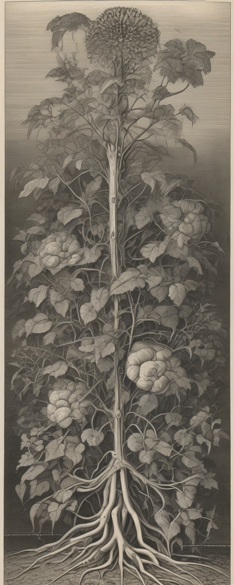
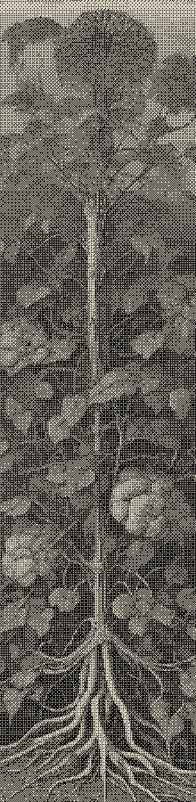

# DTHR.EXE

A Windows desktop app for turning images into two-color prints. Generate an original locally with SDXL or import a PNG, JPEG or WebP. The original stays in the cache while you adjust the palette, crop, pixel size and dithering in a live preview.

| SDXL original | Two-color print |
| :---: | :---: |
|  |  |

Both images come from one generation with seed `123456`. The LLMBAZ panel uses a 4 × 4 Bayer matrix and just two colors, `#d8d0c0` and `#111111`, at 220 × 900 pixels.

## Run from source

From the repository root in PowerShell, using 64-bit Python 3.13.5 on Windows:

```powershell
py -3.13 -m venv .venv
.\.venv\Scripts\python -m pip install torch==2.9.1 torchvision==0.24.1 --index-url https://download.pytorch.org/whl/cu128
.\.venv\Scripts\python -m pip install -r requirements.lock
.\.venv\Scripts\python -m dthr gui
```

Choose **File → Import image** to start editing. For local generation, install **sdxl-base** from **Tools → Model Manager** (about 7 GB). Once installed, it works offline. GPU generation was tested on an RTX 5090.

The CLI and authenticated local HTTP API use the same image engine as the desktop app. The [user guide](docs/guide.md) covers effects, daily panel pairs, agent requests and building the standalone Windows package.
